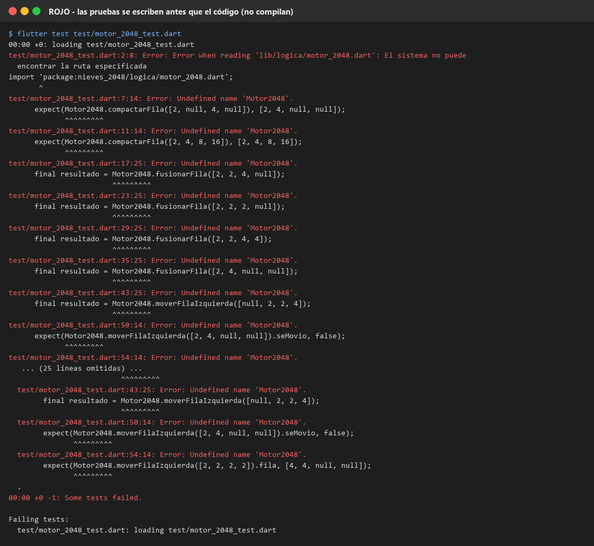
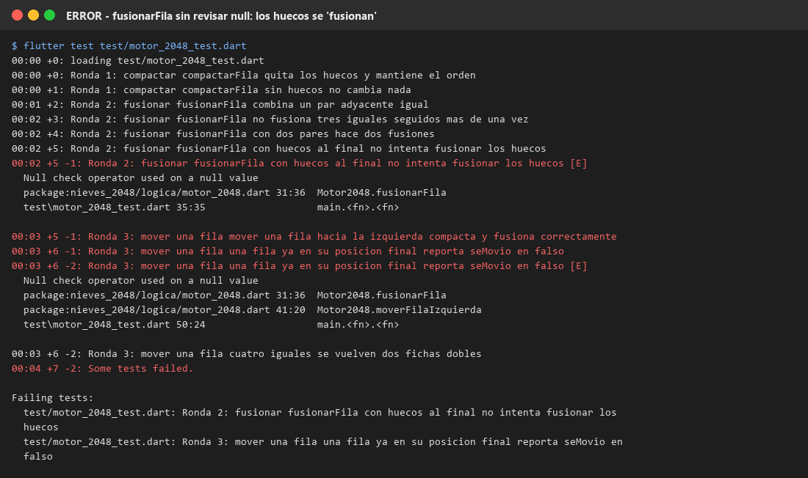
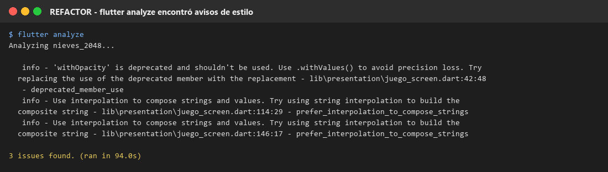
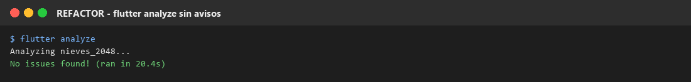
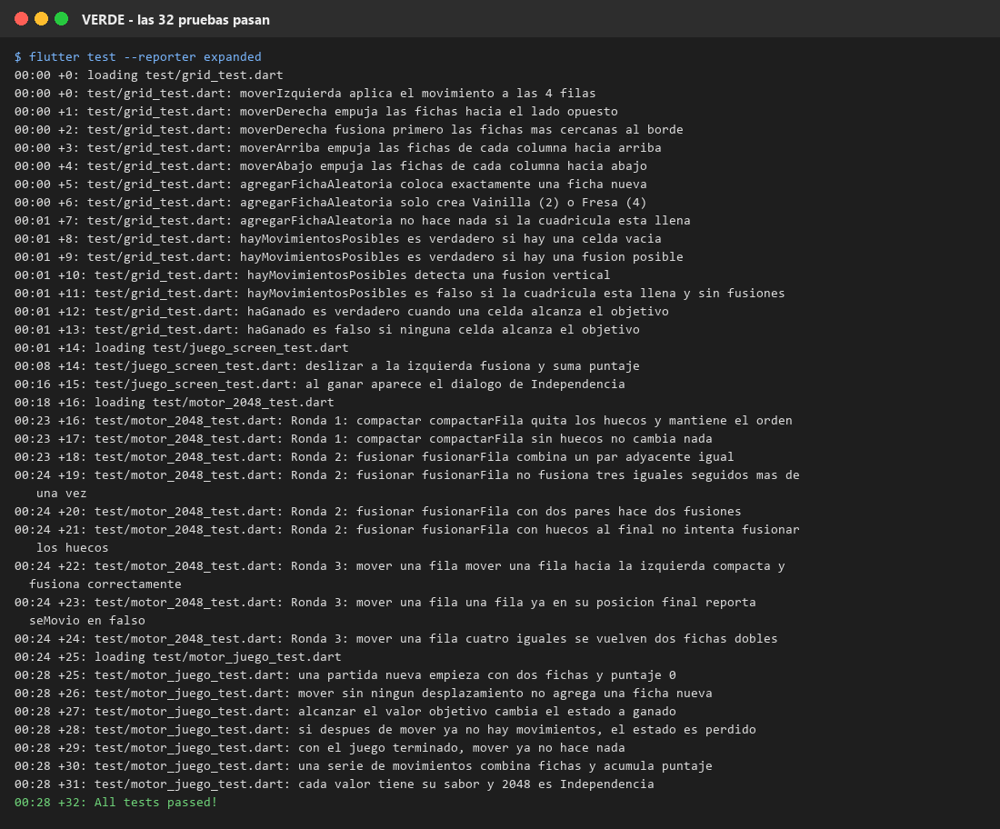
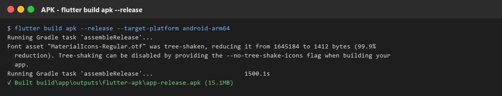
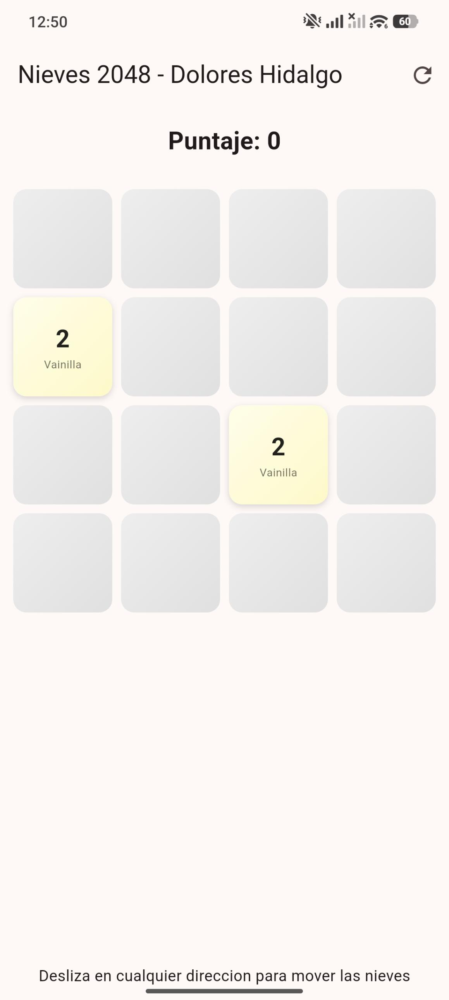
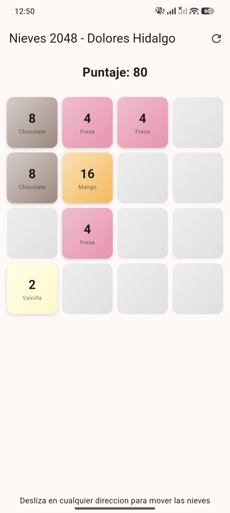
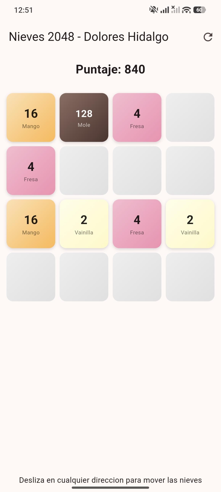
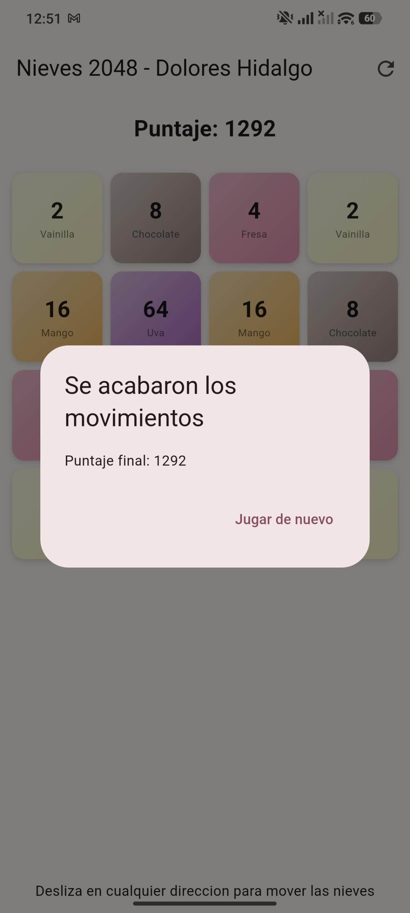

# Nieves 2048 — juego de fusión de sabores con TDD

Juego de fusión en una cuadrícula de 4×4 donde cada valor es un **sabor de nieve de Dolores Hidalgo**: 2 Vainilla,
4 Fresa, 8 Chocolate… 128 **Mole**… y la ficha final **2048 "¡Independencia!"** con los colores de la bandera.
Construido con **TDD** siguiendo el *Manual paso a paso con TDD — Nieves 2048*: compactar, fusionar sin fusionar tres
veces, mover en 4 direcciones reutilizando un solo algoritmo (invertir y transponer), fichas nuevas con `Random`
inyectado, victoria y derrota. Las fichas tienen degradados y animación de aparición.

---

## 📦 APK

| Archivo | Ruta |
|---|---|
| Lista para instalar | `apk/Nieves2048.apk` (15.1 MB) |
| Salida de Flutter | `build/app/outputs/flutter-apk/app-release.apk` |

```bash
flutter build apk --release --target-platform android-arm64
```

El APK es para teléfonos **arm64** (prácticamente todos los Android de los últimos años). Para instalar: copia el `.apk` al teléfono, ábrelo y acepta *instalar apps de origen desconocido*.

---

## 🏗️ Estructura

```
lib/
├── logica/         motor_2048 (una fila) · grid (4x4) · motor_juego (partida) · sabores · direccion · estado_juego
├── presentation/   juego_screen.dart  (gestos de deslizar + fichas con degradado)
└── main.dart
test/
├── motor_2048_test.dart     compactar · fusionar · mover una fila
├── grid_test.dart           4 direcciones · ficha nueva · fin del juego · victoria
├── motor_juego_test.dart    partida completa, puntaje, ganado/perdido, sabores
└── juego_screen_test.dart   deslizar en la pantalla y diálogo de victoria
```

---

## 🔴🟢🔵 Evidencia del ciclo TDD

### 1. 🔴 ROJO — las pruebas se escriben primero y fallan

Las pruebas de `test/` se escribieron **antes** que el código. Al correr `flutter test` con `lib/` todavía vacía, nada compila:



### 2. ❌ Error real atrapado por una prueba

Primero se programó `fusionarFila` **sin revisar que la celda tuviera ficha**:

```dart
if (resultado[i] == resultado[i + 1]) {          // ❌ null == null también "empata"
  resultado[i] = resultado[i]! * 2;
```

Con una fila como `[2, 4, null, null]` los dos huecos se consideran "iguales" y `null! * 2` revienta. Las pruebas
*"fusionarFila con huecos al final no intenta fusionar los huecos"* y *"una fila ya en su posición final"* lo atraparon
(`Null check operator used on a null value`):



**Corrección:**

```dart
// Un hueco (null) nunca se fusiona: sin esta revisión null == null "empata".
if (resultado[i] != null && resultado[i] == resultado[i + 1]) {   // ✅
```

### 3. 🔵 REFACTOR — limpiar sin romper nada

`flutter analyze` señaló avisos en la pantalla copiada del manual (concatenación de textos con `+` y
`withOpacity`, que ya está obsoleto en Flutter 3.27+):



Se corrigieron y se volvió a analizar:



### 4. 🟢 VERDE — las 32 pruebas pasan



### 5. 📦 Compilación del APK



---

## ✅ Qué cubren las pruebas

| Grupo | Lo que se verifica |
|---|---|
| Una fila | compactar huecos, fusionar pares, **no** fusionar 3 iguales dos veces, `[2,2,2,2]` → `[4,4]`, `seMovio` |
| Cuadrícula | izquierda/derecha/arriba/abajo, la fusión más cercana al borde va primero |
| Fichas nuevas | exactamente una, solo Vainilla (2) o Fresa (4), nada si está llena (Random con semilla) |
| Fin | hay movimientos con hueco / fusión horizontal / vertical; sin movimientos = perdido; 2048 = ganado |
| Partida | 2 fichas al inicio, mover sin desplazar no agrega ficha, puntaje acumulado, sin jugadas tras terminar |
| Pantalla | deslizar con el dedo fusiona y suma puntos; diálogo "Independencia lograda!" |

```bash
flutter test
```

---

## 📱 Capturas de la app

> Tomadas en un teléfono físico con el APK instalado. *Guarda tus capturas en `capturas/` con estos nombres y aparecerán aquí automáticamente.*

| Partida nueva | Después de varias fusiones | Llegando a Mole (128) |
|---|---|---|
|  |  |  |

| Se acabaron los movimientos | ¡Independencia! (2048) |
|---|---|
|  |  |

### Qué probar en la app

| Caso | Qué hacer | Resultado esperado |
|---|---|---|
| Mover | Desliza en cualquier dirección | Las nieves se mueven y aparece una nueva |
| Fusión | Junta dos fichas iguales | Se convierten en el siguiente sabor y sube el puntaje |
| Sin movimiento | Desliza hacia donde nada se mueve | No aparece ficha nueva |
| Reiniciar | Botón ⟳ arriba a la derecha | Partida nueva con 2 fichas |

---

## 🛠️ Cómo correr el proyecto

```bash
flutter pub get
```

```bash
flutter test
```

```bash
flutter run
```

